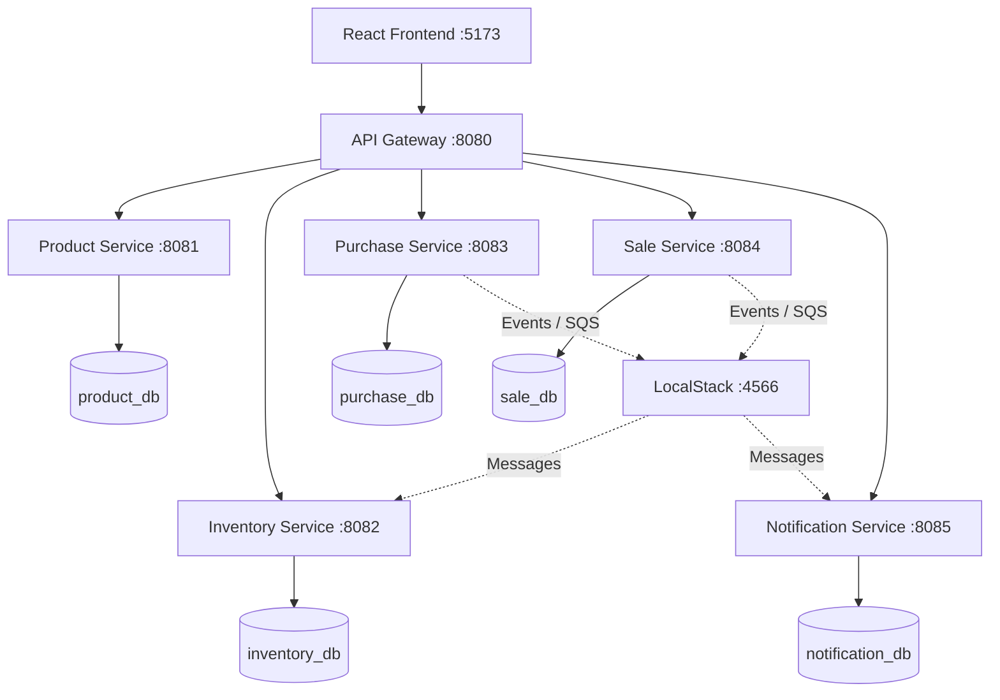

# Inventory Microservices

A Java Spring Boot microservices application with PostgreSQL, Spring Cloud Gateway, asynchronous messaging using LocalStack/SQS, and a React frontend.

## Architecture



Each service owns its database. Clients access backend APIs through the API Gateway.

## Technology Stack

- **Backend:** Java, Spring Boot, Spring Cloud Gateway, OpenFeign
- **Persistence:** Spring Data JPA, Hibernate, PostgreSQL
- **Messaging:** AWS SQS-compatible LocalStack
- **Frontend:** React, Vite, JavaScript
- **Testing:** Postman, Newman
- **Observability:** Prometheus, Grafana, Loki, Promtail, Jaeger
- **Build and version control:** Maven Wrapper, Docker Compose, Git

## Services and Ports

| Component | Port | Documentation |
|---|---:|---|
| API Gateway | 8080 | [API Catalog](http://localhost:8080/docs) |
| Product Service | 8081 | [Swagger UI](http://localhost:8081/swagger-ui.html) |
| Inventory Service | 8082 | [Swagger UI](http://localhost:8082/swagger-ui.html) |
| Purchase Service | 8083 | [Swagger UI](http://localhost:8083/swagger-ui.html) |
| Sale Service | 8084 | [Swagger UI](http://localhost:8084/swagger-ui.html) |
| Notification Service | 8085 | [Swagger UI](http://localhost:8085/swagger-ui.html) |
| Frontend | 5173 | React/Vite development server |
| PostgreSQL | 5433 | Local host port |
| LocalStack | 4566 | Local AWS-compatible services |
| Prometheus | 9090 | Metrics |
| Grafana | 3000 | Dashboards |
| Jaeger | 16686 | Traces |
| Loki | 3100 | Log aggregation |

## API Documentation

- [API Catalog](http://localhost:8080/docs)
- [OpenAPI JSON - Gateway](http://localhost:8080/v3/api-docs)
- Detailed endpoint list: [docs/API-DOCUMENTATION.md](docs/API-DOCUMENTATION.md)

Each service also exposes its own OpenAPI specification at `/v3/api-docs`.

## Prerequisites

- Docker Desktop with Docker Compose
- Node.js and npm for frontend development
- Git
- A Java/Maven installation is optional for container-based startup; use the repository Maven Wrapper for local builds.

## Configuration

1. Review `.env.example` for the required environment variables.
2. Create or review your local `.env.docker` file using your own local values.
3. Never commit real passwords, access keys, or other secrets.

### Environment Variables

| Variable | Purpose |
|---|---|
| `POSTGRES_USER` | PostgreSQL username |
| `POSTGRES_PASSWORD` | PostgreSQL password |
| `PRODUCT_DB` | Product service database |
| `INVENTORY_DB` | Inventory service database |
| `PURCHASE_DB` | Purchase service database |
| `SALE_DB` | Sale service database |
| `NOTIFICATION_DB` | Notification service database |
| `PRODUCT_SERVICE_URL` | Product service internal URL |
| `INVENTORY_SERVICE_URL` | Inventory service internal URL |
| `PURCHASE_SERVICE_URL` | Purchase service internal URL |
| `SALE_SERVICE_URL` | Sale service internal URL |
| `NOTIFICATION_SERVICE_URL` | Notification service internal URL |
| `AWS_REGION` | AWS-compatible region |
| `AWS_ACCESS_KEY_ID` | Local AWS-compatible access key |
| `AWS_SECRET_ACCESS_KEY` | Local AWS-compatible secret key |
| `AWS_ENDPOINT_URL` | LocalStack endpoint |
| `AWS_ENDPOINT_URL_SQS` | LocalStack SQS endpoint |
| `SQS_ENDPOINT_STRATEGY` | SQS endpoint addressing strategy |
| `SQS_LISTENER_AUTO_STARTUP` | Controls SQS listener startup |
| `PURCHASE_EVENTS_QUEUE` | Purchase events queue |
| `STOCK_RESERVATION_REQUESTS_QUEUE` | Stock reservation request queue |
| `SALE_EVENTS_QUEUE` | Sale events queue |
| `STOCK_RESERVED_QUEUE` | Successful stock reservation queue |
| `STOCK_INSUFFICIENT_QUEUE` | Insufficient-stock queue |
| `LOW_STOCK_ALERTS_QUEUE` | Low-stock alerts queue |
| `FRONTEND_ORIGIN` | Primary frontend CORS origin |
| `FRONTEND_ORIGIN_ALT` | Alternate frontend CORS origin |

The exact values depend on the local environment. Refer to `.env.example` and `docker-compose.yml`.

## Start the Application

Run these commands from the repository root in a terminal:

```cmd
docker compose --env-file .env.docker config --quiet
docker compose --env-file .env.docker up -d --build
docker compose --env-file .env.docker ps
```

If a service is unhealthy or unavailable, inspect its logs:

```cmd
docker compose --env-file .env.docker logs --tail=100 api-gateway
docker compose --env-file .env.docker logs --tail=100 product-service
docker compose --env-file .env.docker logs --tail=100 inventory-service
```

Open the API catalog at http://localhost:8080/docs.

To stop the containers without deleting persistent data:

```cmd
docker compose --env-file .env.docker down
```

Do not use `down -v` unless you intentionally want to remove persistent volumes and their data.

## Run the Frontend

```cmd
cd frontend
npm install
npm run dev
```

Open http://localhost:5173.

## Testing

Use the Postman collection in the repository to test APIs through the gateway at `http://localhost:8080`. Newman can run an exported collection with:

```cmd
npx newman run inventory-ms-tests.json
```

Use the actual collection filename present in your working directory.

## Observability

When the corresponding Compose services are running:

- Prometheus: http://localhost:9090
- Grafana: http://localhost:3000
- Jaeger: http://localhost:16686

Loki and Promtail provide log aggregation and forwarding.

## Repository Documentation

- [API Documentation](docs/API-DOCUMENTATION.md)
- [Frontend README](frontend/README.md)
- [API Gateway README](services/api-gateway/README.md)
- [Product Service README](services/product-service/README.md)
- [Inventory Service README](services/inventory-service/README.md)
- [Purchase Service README](services/purchase-service/README.md)
- [Sale Service README](services/sale-service/README.md)
- [Notification Service README](services/notification-service/README.md)
