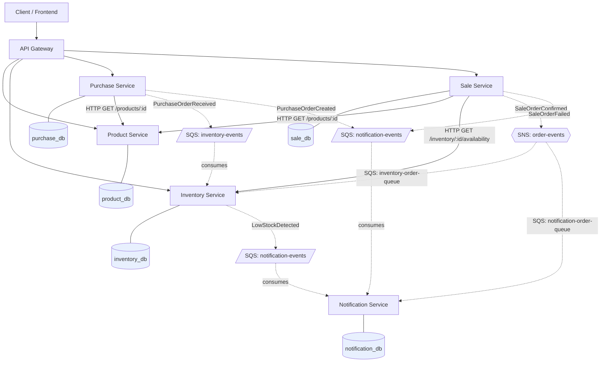

# Inventory App — Microservices Architecture

Pure design document. No code yet — this defines service boundaries, data
ownership, and communication patterns before implementation begins.

## Services

| Service | Responsibility |
|---|---|
| **Product** | Product catalog: SKUs, names, descriptions, categories, list price |
| **Inventory** | Stock levels per warehouse, reorder thresholds, stock ledger/movements |
| **Purchase** | Purchase orders (buying stock from suppliers), supplier records |
| **Sale** | Sales orders (selling stock to customers), customer order history |
| **Notification** | Delivers alerts/emails from domain events; owns no business data |

---

## 1. Data Ownership (Database-per-Service)

Each service owns its data exclusively. No service reaches into another
service's tables directly — everything crosses a boundary through an API or
an event.

### Product Service — `product_db`
- `products` (id, sku, name, description, category_id, unit_price, active, created_at, updated_at)
- `categories` (id, name, parent_id)

### Inventory Service — `inventory_db`
- `warehouses` (id, name, location)
- `stock_levels` (product_id, warehouse_id, quantity_on_hand, quantity_reserved, reorder_threshold)
- `stock_movements` (id, product_id, warehouse_id, delta, reason, source_event_id, created_at) — audit ledger

### Purchase Service — `purchase_db`
- `suppliers` (id, name, contact_info)
- `purchase_orders` (id, supplier_id, status, created_at)
- `purchase_order_items` (po_id, product_id, quantity, unit_cost)

### Sale Service — `sale_db`
- `customers` (id, name, contact_info)
- `sales_orders` (id, customer_id, status, created_at)
- `sales_order_items` (order_id, product_id, quantity, unit_price)

### Notification Service — `notification_db`
- `notification_templates` (id, event_type, channel, template_body)
- `notification_log` (id, event_type, recipient, channel, status, sent_at) — delivery audit only, not source-of-truth business data

**Rule of thumb:** if Product Service needs a product's current stock, it
asks Inventory Service — it never queries `inventory_db` directly. Product
Service doesn't even know `inventory_db` exists.

---

## 2. Communication: Sync (HTTP) vs Async (SQS)

### Synchronous — HTTP/REST
Used only where the calling service needs an immediate answer to make a
decision *right now* (can't proceed without it).

| Caller | Callee | Call | Why sync |
|---|---|---|---|
| Sale Service | Product Service | `GET /products/{id}` | Needs current price/details to build the order line item |
| Sale Service | Inventory Service | `GET /inventory/{productId}/availability?warehouseId=` | Must confirm stock is available *before* committing the order — prevents overselling |
| Purchase Service | Product Service | `GET /products/{id}` | Validates the product exists before adding it to a PO line item |

### Asynchronous — SQS (event-driven)
Used for everything that changes state as a *side effect* of something that
already happened. The publishing service doesn't wait, and doesn't care who
(if anyone) is listening.

| Publisher | Event | Consumer(s) | Effect |
|---|---|---|---|
| Purchase Service | `PurchaseOrderReceived` | Inventory Service | Increases `quantity_on_hand` |
| Purchase Service | `PurchaseOrderCreated` | Notification Service | Notifies procurement/supplier |
| Sale Service | `SaleOrderConfirmed` | Inventory Service | Decreases `quantity_on_hand` / releases reservation |
| Sale Service | `SaleOrderConfirmed` | Notification Service | Sends order confirmation to customer |
| Sale Service | `SaleOrderFailed` | Notification Service | Sends failure notice (e.g. stock ran out mid-checkout) |
| Inventory Service | `LowStockDetected` | Notification Service | Alerts procurement team to reorder |

**Why the split:** the *check* before committing an order is sync because
the outcome changes the business decision immediately (don't sell what you
don't have). The *update* after committing is async because Sale and
Purchase don't need to block on Inventory's write succeeding — it's fine if
the stock ledger catches up a second later. This also means Inventory being
briefly slow or restarting doesn't take down checkout.

> **Note on fan-out:** `SaleOrderConfirmed` has two consumers (Inventory and
> Notification). Plain SQS is one-queue-one-consumer, so in practice this
> is implemented as an SNS topic with one SQS queue per subscriber
> (SNS → SQS fan-out), not one queue read by two services.

---

## 3. Databases

| # | Database | Owner | Engine |
|---|---|---|---|
| 1 | `product_db` | Product Service | PostgreSQL |
| 2 | `inventory_db` | Inventory Service | PostgreSQL |
| 3 | `purchase_db` | Purchase Service | PostgreSQL |
| 4 | `sale_db` | Sale Service | PostgreSQL |
| 5 | `notification_db` | Notification Service | PostgreSQL (small — audit log only) |

Plus infrastructure (not a service database, but shared plumbing):
- **Message broker:** AWS SQS (+ SNS for fan-out topics)
- **API Gateway:** single entry point for external/client HTTP traffic, routes to the 5 services

---

## 4. Architecture Diagram

Solid arrows = synchronous HTTP calls (blocking, need an answer now).
Dashed arrows = asynchronous events over SQS/SNS (fire-and-forget, eventual
consistency).

---

## 5. Design Rationale Summary

- **Database-per-service** keeps each team/service free to change its
  schema without coordinating a migration across the whole system, and
  makes the ownership boundary unambiguous — if you need data you don't
  own, you call an API or listen for an event, you never query another
  service's tables.
- **Sync HTTP is reserved for decisions**, not updates. The only two
  services callable synchronously by others are Product (read-only lookup)
  and Inventory (availability check) — both are simple reads with no side
  effects on the callee.
- **Async SQS is reserved for consequences.** Anything that happens
  *because* an order was placed or received is published as an event and
  handled independently, so a slow or temporarily-down consumer (e.g.
  Notification) never blocks a purchase or sale from completing.
- **Notification Service owns no business data.** It's a pure event
  consumer/dispatcher with only an audit log — it can be added, removed, or
  rebuilt without any other service knowing.

## Next Steps (not in this document)

- API contracts (OpenAPI specs) for the three sync endpoints
- Event schemas (JSON) for the six async events, with versioning strategy
- Retry/DLQ policy per SQS queue
- Service discovery / API Gateway routing config
